# Beacon — architecture diagrams

What is built today, and what the next phases add. Every diagram is generated from a source file in docs/diagrams/src.

**Three ways to read these.** Open [docs/diagrams/index.html](diagrams/index.html) in a browser for the viewer (filter, zoom, SVG/PNG export, print-to-PDF of the whole set — it works offline, straight from the filesystem). Scroll this file to read them on GitHub, which renders Mermaid natively. Or read the sources under [docs/diagrams/src](diagrams/src), which is what review and diffs are for.

Generated by `npm run diagrams (scripts/build-diagrams.mjs)` — **do not edit this file by hand**; edit the `.mmd` source and regenerate.

| # | Diagram | Kind | Status |
|---|---|---|---|
| 1 | [System context (C4 level 1)](#system-context-c4-level-1) | C4 context | Built today |
| 2 | [Containers (C4 level 2)](#containers-c4-level-2) | C4 container | Built today |
| 3 | [Inside the brain (C4 level 3)](#inside-the-brain-c4-level-3) | C4 component | Built today |
| 4 | [Code map and import rules (C4 level 4)](#code-map-and-import-rules-c4-level-4) | module dependency | Built today |
| 5 | [API surface and its guards](#api-surface-and-its-guards) | flowchart | Built today |
| 6 | [Data flow level 0 (context DFD)](#data-flow-level-0-context-dfd) | DFD level 0 | Built today |
| 7 | [Data flow level 1 (processes and stores)](#data-flow-level-1-processes-and-stores) | DFD level 1 | Built today |
| 8 | [Data flow level 2 — the detector](#data-flow-level-2-the-detector) | DFD level 2 | Built today |
| 9 | [How state is kept (base + decision log)](#how-state-is-kept-base-decision-log) | flowchart | Built today |
| 10 | [Privacy boundary — what leaves, what never does](#privacy-boundary-what-leaves-what-never-does) | flowchart | Built today |
| 11 | [Failure modes and graceful degradation](#failure-modes-and-graceful-degradation) | decision flow | Built today |
| 12 | [Sequence — one scheduled agent run](#sequence-one-scheduled-agent-run) | sequence | Built today |
| 13 | [Sequence — hidden blocker to approved change](#sequence-hidden-blocker-to-approved-change) | sequence | Built today |
| 14 | [Sequence — the one-field update composer](#sequence-the-one-field-update-composer) | sequence | Built today |
| 15 | [State — the life of a work item](#state-the-life-of-a-work-item) | state machine | Built today |
| 16 | [State — the life of a signal and its proposal](#state-the-life-of-a-signal-and-its-proposal) | state machine | Built today |
| 17 | [Journey — one day, by role](#journey-one-day-by-role) | user journey | Built today |
| 18 | [Data model today](#data-model-today) | ER diagram | Built today |
| 19 | [Deployment today — three ways to run it](#deployment-today-three-ways-to-run-it) | deployment | Built today |
| 20 | [Observability — how you find out something is wrong](#observability-how-you-find-out-something-is-wrong) | flowchart | Partly built |
| 21 | [Threat model — threat to control](#threat-model-threat-to-control) | flowchart | Partly built |
| 22 | [Target architecture (phases 4–5)](#target-architecture-phases-45) | C4 container | Not built yet |
| 23 | [Data flow — two-way tracker sync (phase 4)](#data-flow-two-way-tracker-sync-phase-4) | DFD level 1 | Not built yet |
| 24 | [Sequence — webhook in, approved write out (phase 4)](#sequence-webhook-in-approved-write-out-phase-4) | sequence | Not built yet |
| 25 | [Deployment target (pilot and enterprise)](#deployment-target-pilot-and-enterprise) | deployment | Not built yet |
| 26 | [Identity, roles and erasure (phase 4)](#identity-roles-and-erasure-phase-4) | class diagram | Not built yet |
| 27 | [Data model additions (phases 4–5)](#data-model-additions-phases-45) | ER diagram | Not built yet |
| 28 | [Roadmap — phases 1 to 5](#roadmap-phases-1-to-5) | gantt | Partly built |

### Colour legend

| Fill | Meaning |
|---|---|
| navy | a person, or the browser they use |
| teal | a Beacon process or the core computation |
| pale teal | a module inside a process (not a service) |
| sand | a data store |
| grey, dashed | an external system |
| pale red | a human gate, or a risk worth looking at |
| purple, dashed | **not built yet** (phase 4 or 5) |

## 1 · System structure

_Zooming in: who uses Beacon, which processes exist, what is inside them, and which module may import which._

### System context (C4 level 1)

**Built today** · C4 context · source: [`src/01-context.mmd`](diagrams/src/01-context.mmd)

The one-page answer to "what is this thing and who touches it": three roles, Beacon in the middle, and three external systems.

> **How to read it.** Start with a person on the left and follow their arrow in, then follow what comes back out. Two arrows carry the product's whole stance: Beacon asks the AUTHOR to confirm before anyone else is told, and it writes back to the tracker only what a human approved.

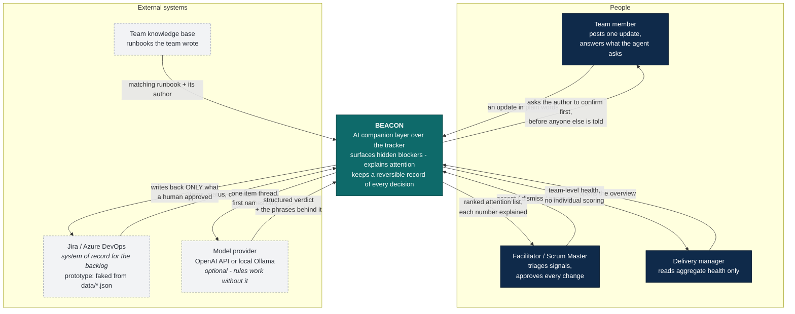

<details><summary>What to check when reviewing it</summary>

- Is any role missing an arrow it needs?
- Is anything shown as an input that the system cannot actually see?

</details>

### Containers (C4 level 2)

**Built today** · C4 container · source: [`src/02-containers.mmd`](diagrams/src/02-containers.mmd)

The processes and stores that exist when Beacon is running: a browser, one Next.js server (UI + API + brain), the agent worker, and one of two stores.

> **How to read it.** Everything in the big box is one process — the brain is a library, not a service, which is why the browser and the server can never disagree about a score. The agent worker contains no logic at all: it is a clock that calls an endpoint.

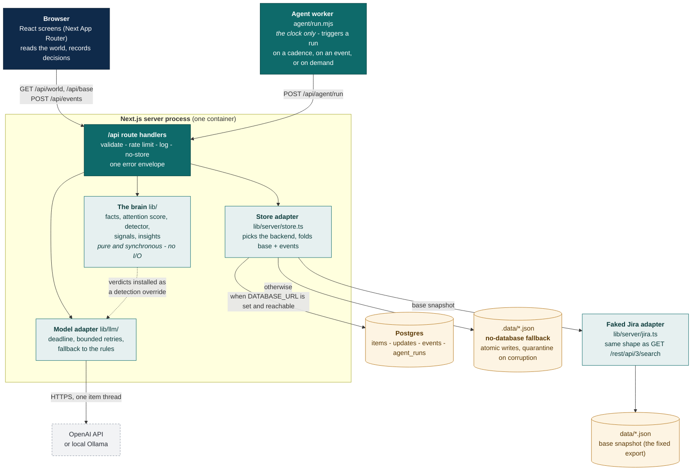

<details><summary>What to check when reviewing it</summary>

- Could the brain be imported by the browser and the server and still behave identically? (It must.)
- Is the store choice visible to an operator at runtime? (/api/health says which one is live.)

</details>

### Inside the brain (C4 level 3)

**Built today** · C4 component · source: [`src/03-components-brain.mmd`](diagrams/src/03-components-brain.mmd)

The computation, in the order it happens: world → facts → detection → score → signals → questions and proposals.

> **How to read it.** Follow the arrows top to bottom; that is one run. The dashed arrow is the only way a model gets in — as a verdict for one exact piece of text, installed for the length of a run. Everything else is deterministic.

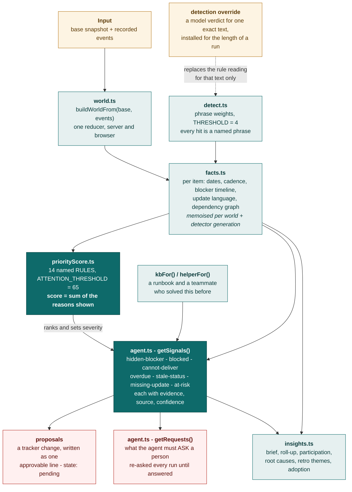

<details><summary>What to check when reviewing it</summary>

- Does anything downstream of the score write back upstream? (It must not.)
- Where would a new rule go, and would it show up in the reasons list automatically?

</details>

### Code map and import rules (C4 level 4)

**Built today** · module dependency · source: [`src/04-code-map.mmd`](diagrams/src/04-code-map.mmd)

Which module imports which, in three zones: the browser bundle, the shared brain, and server-only code.

> **How to read it.** The rule this diagram exists to enforce: nothing in the right-hand zone (lib/server, lib/llm, config) may ever be imported by a screen. If it were, a database URL or a model key would end up in the browser bundle.

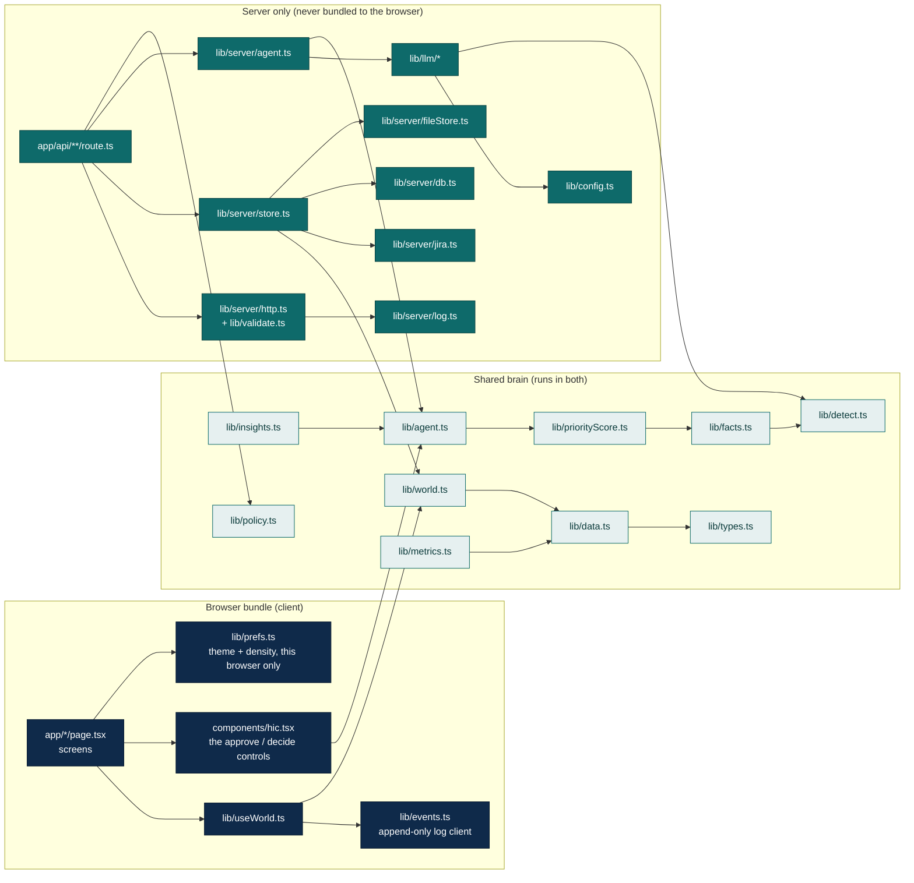

<details><summary>What to check when reviewing it</summary>

- Trace any screen to the right-hand zone — there should be no path.
- Does the shared middle zone do any I/O? (It must not.)

</details>

### API surface and its guards

**Built today** · flowchart · source: [`src/05-api-surface.mmd`](diagrams/src/05-api-surface.mmd)

All ten endpoints (fourteen method-path pairs), grouped by what they can do: read, call a model, or change recorded state.

> **How to read it.** Read the guard box first — it applies to every route, which is why the route files themselves are four lines long. Then check the group a route sits in: that is the honest answer to "what can this endpoint do to me".

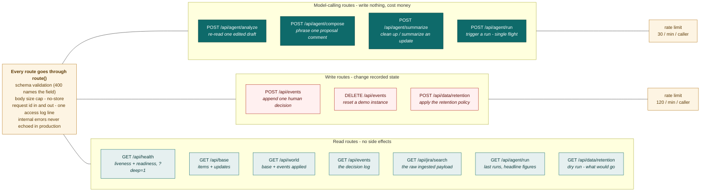

<details><summary>What to check when reviewing it</summary>

- Is any route in the wrong group?
- Should any read route also be rate limited?

</details>

## 2 · Data flow

_What data moves, where it rests, and where the trust boundaries are. Levels 0 → 2, in the usual DFD sense._

### Data flow level 0 (context DFD)

**Built today** · DFD level 0 · source: [`src/06-dfd-level0.mmd`](diagrams/src/06-dfd-level0.mmd)

Beacon as a single process, with every external entity and every labelled flow F1–F9 crossing the trust boundary.

> **How to read it.** The dashed box is the trust boundary. Flows that cross it are the ones a security or privacy review cares about — especially F8, the only flow that leaves infrastructure you control, and F7, the only flow that changes someone else's system.

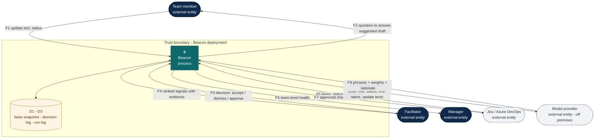

<details><summary>What to check when reviewing it</summary>

- Is F8 the minimum data that could possibly do the job?
- Can F7 happen without a recorded human approval? (No — see diagram 13.)

</details>

### Data flow level 1 (processes and stores)

**Built today** · DFD level 1 · source: [`src/07-dfd-level1.mmd`](diagrams/src/07-dfd-level1.mmd)

The nine numbered processes and four data stores, with every arrow labelled with what actually moves.

> **How to read it.** Follow 1 → 9 in order for a full cycle. Processes 7, 8 and 9 are red because they are the only ones that change stored state, and each has a human or a schedule behind it, never the agent on its own.

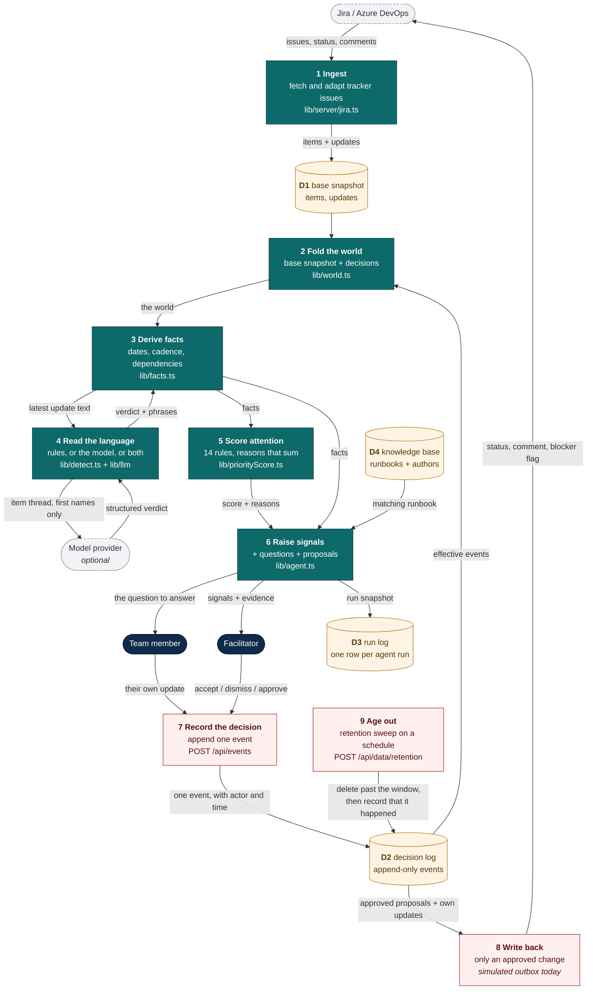

<details><summary>What to check when reviewing it</summary>

- Does every arrow into a store have an identified actor?
- Is there any path from process 6 (raise signals) directly to process 8 (write back)? There must not be — 7 sits between them.

</details>

### Data flow level 2 — the detector

**Built today** · DFD level 2 · source: [`src/08-dfd-level2-detection.mmd`](diagrams/src/08-dfd-level2-detection.mmd)

Process 4 expanded: how a piece of update text becomes an explainable verdict, with or without a model.

> **How to read it.** The two boxes that carry the argument are "normalize" and "fall back to the rules". The model supplies phrases; the score is recomputed from them and the threshold is ours, so a model cannot assert a conclusion the evidence does not support.

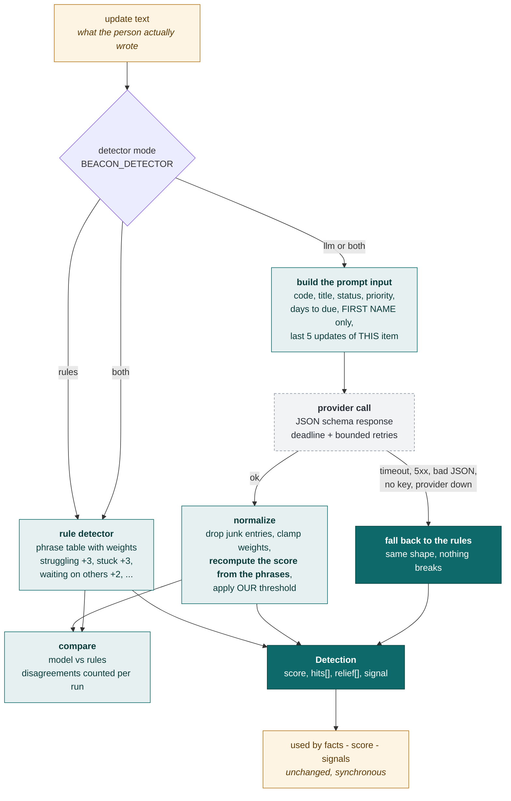

<details><summary>What to check when reviewing it</summary>

- If the provider returned a confident verdict with no phrases, what score would it get? (Zero.)
- Is there any path where a model failure reaches the user as an error? (No — it degrades to rules.)

</details>

### How state is kept (base + decision log)

**Built today** · flowchart · source: [`src/09-event-sourcing.mmd`](diagrams/src/09-event-sourcing.mmd)

A read-only base snapshot plus an append-only log of human decisions, folded by one reducer that both the server and the browser run.

> **How to read it.** Note which event kinds are in the upper box: only two of the eight can change an item. The rest are recorded because they are evidence about the agent's usefulness, not because they change the board.

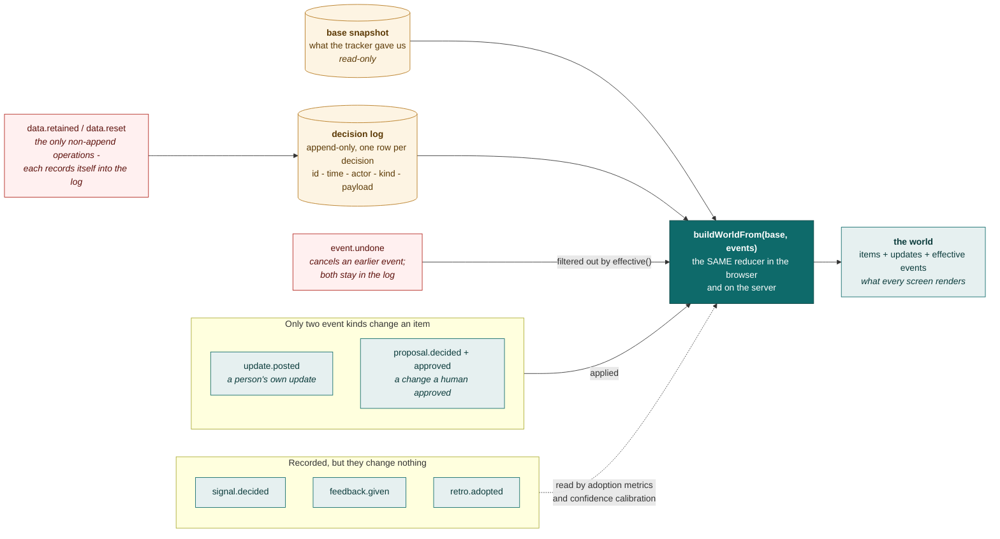

<details><summary>What to check when reviewing it</summary>

- Could a signal decision silently change an item? (No.)
- How is a mistake corrected? (A new event — event.undone — never by editing the log.)

</details>

### Privacy boundary — what leaves, what never does

**Built today** · flowchart · source: [`src/10-privacy-boundary.mmd`](diagrams/src/10-privacy-boundary.mmd)

Three columns: what stays in the viewer's browser, what stays in our store, and the short list that can leave for a model provider.

> **How to read it.** Read the "never sent" box as a specification, not a reassurance — it is what lib/llm/types.ts actually allows into a prompt. The default configuration sends nothing at all: with no key, the rule detector runs.

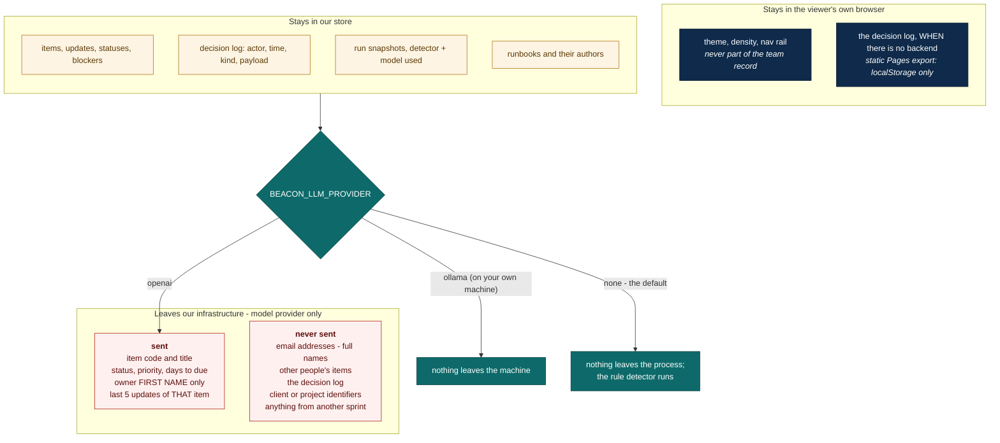

<details><summary>What to check when reviewing it</summary>

- Does anything in "sent" identify a person beyond a first name?
- If a customer forbids external model calls, what changes? (One environment variable.)

</details>

### Failure modes and graceful degradation

**Built today** · decision flow · source: [`src/11-degradation.mmd`](diagrams/src/11-degradation.mmd)

Every branch for "something is down", each ending in a state that still works and is visible to an operator.

> **How to read it.** Follow any "no" branch to its end: none of them reaches a dead end. The point is that the model and the database are both optional in different ways — the model is optional by design, the database is optional with a stated downgrade.

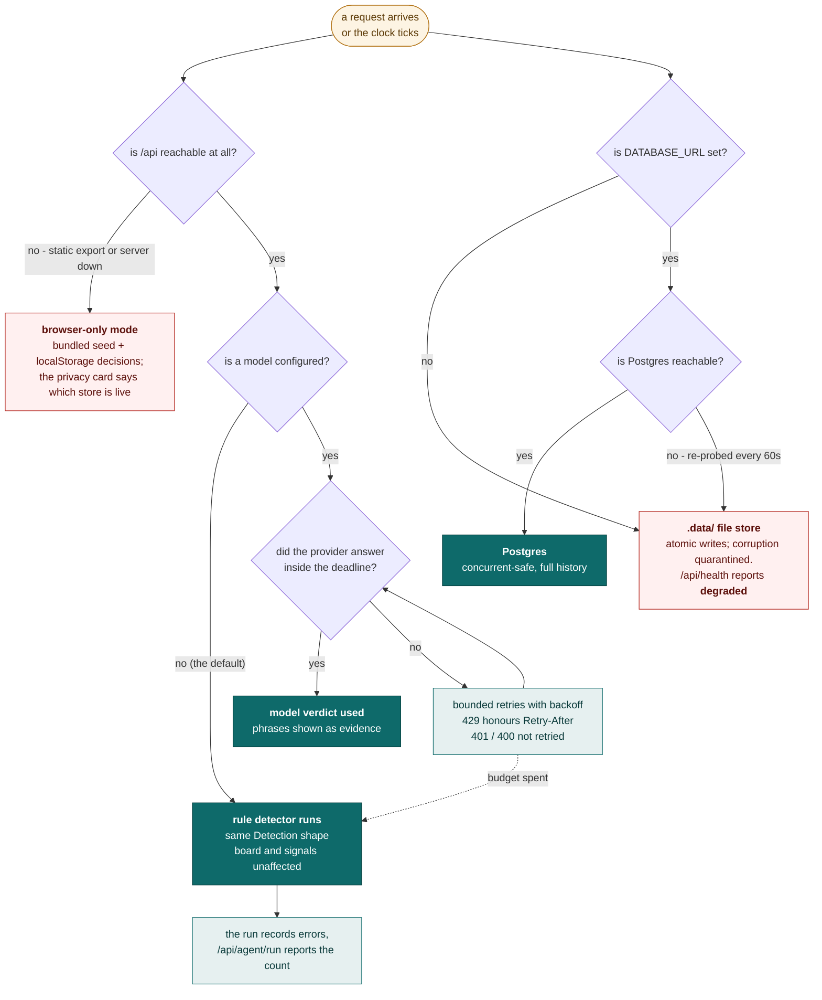

<details><summary>What to check when reviewing it</summary>

- Which failures are silent? (None — each is logged or reported by /api/health.)
- Is the file-store fallback ever chosen after Postgres has worked? (No — that would split the log.)

</details>

## 3 · Behaviour over time

_The three sequences that matter, plus the lifecycle of an item and of a signal._

### Sequence — one scheduled agent run

**Built today** · sequence · source: [`src/12-seq-agent-run.mmd`](diagrams/src/12-seq-agent-run.mmd)

The clock triggers a run; the server loads the world, reads each item's language, computes, and records one run row.

> **How to read it.** Check what is missing: there is no arrow to the tracker and no item change. A run reads, computes and records. The loop shows the model call and its fallback side by side.

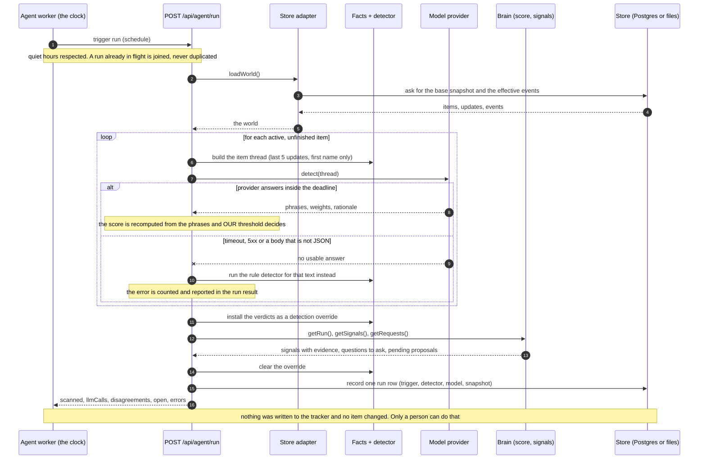

<details><summary>What to check when reviewing it</summary>

- What happens if a run takes longer than the interval? (Single flight — the next trigger joins it.)
- Where does cost come from? (One model call per active item per run, which is why the route is rate limited.)

</details>

### Sequence — hidden blocker to approved change

**Built today** · sequence · source: [`src/13-seq-human-in-the-loop.mmd`](diagrams/src/13-seq-human-in-the-loop.mmd)

The product's central claim as a single trace: detected wording → the author is asked first → a previewed proposal → an approval → the tracker.

> **How to read it.** Follow the happy path first, then the two alternatives. The "no" branch matters as much as the "yes": a dismissal is recorded with a reason, and a kind of signal that keeps being dismissed gets retuned rather than kept.

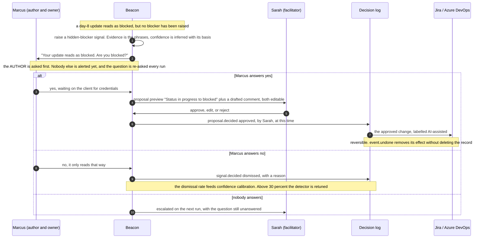

<details><summary>What to check when reviewing it</summary>

- Is the author ever bypassed? (No.)
- Is an approval reversible, and is the reversal visible? (Yes — event.undone.)

</details>

### Sequence — the one-field update composer

**Built today** · sequence · source: [`src/14-seq-update-composer.mmd`](diagrams/src/14-seq-update-composer.mmd)

A person writes or dictates one note; the model tidies it or folds it with the thread; the person confirms every word before anything is posted.

> **How to read it.** Three nested fallbacks, each labelled with the `source` value the response carries: llm, rules, or rules-local. The UI shows which one produced the text, so the copy never claims a model ran when it did not.

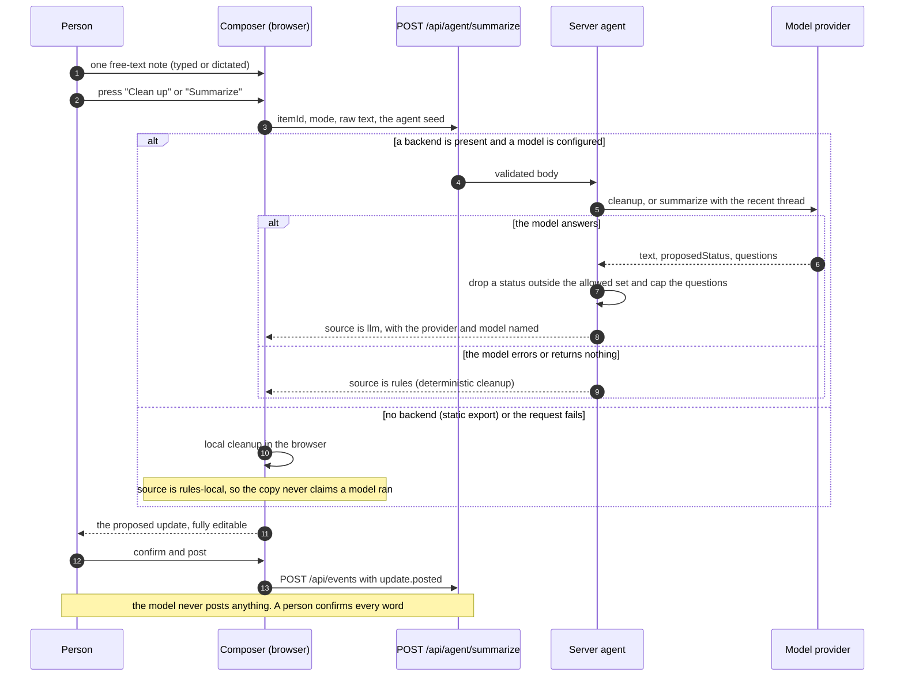

<details><summary>What to check when reviewing it</summary>

- Can the model post anything by itself? (No.)
- With the static export and no backend, do both buttons still work? (Yes — rules-local.)

</details>

### State — the life of a work item

**Built today** · state machine · source: [`src/15-state-item.mmd`](diagrams/src/15-state-item.mmd)

Every status an item can hold and every transition between them, with the scoring consequences of being blocked or overdue.

> **How to read it.** Each transition label names its cause, and every cause is a person. The two notes are the rules that make silence meaningful only where a daily update is actually expected.

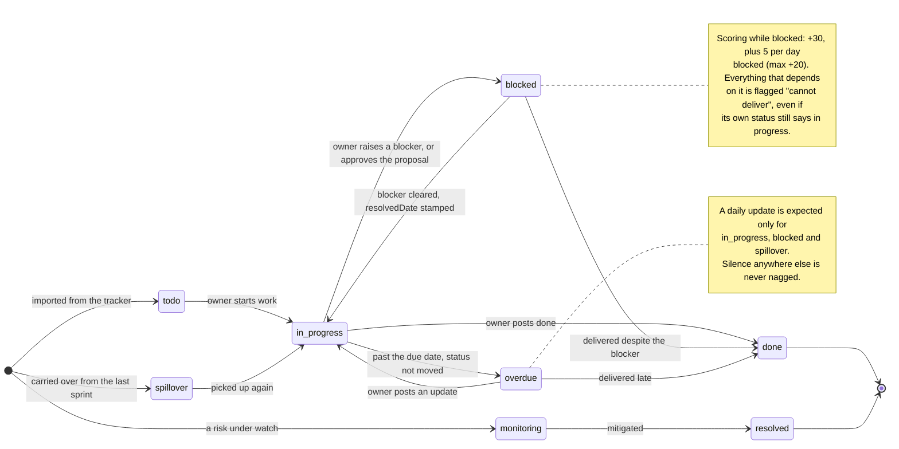

<details><summary>What to check when reviewing it</summary>

- Is there a transition the agent could make alone? (No.)
- Are risks and decisions nagged for daily updates? (No — see the second note.)

</details>

### State — the life of a signal and its proposal

**Built today** · state machine · source: [`src/16-state-signal.mmd`](diagrams/src/16-state-signal.mmd)

Open → accepted, dismissed or snoozed; and the nested lifecycle of the tracker change a signal proposes.

> **How to read it.** The nested box is a separate decision from the signal itself: you can accept that a problem is real and still reject the specific change proposed for it. The note explains how dismissals feed back into stated confidence.

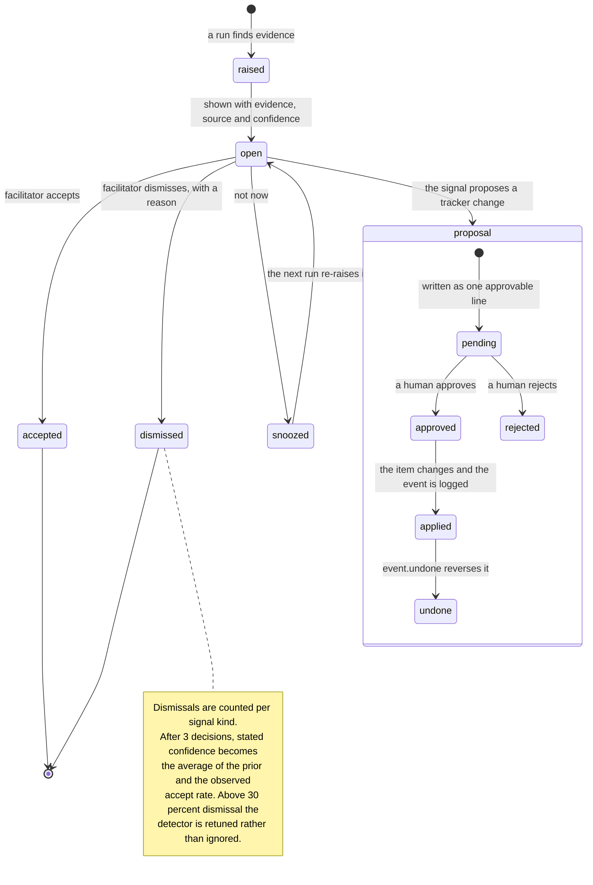

<details><summary>What to check when reviewing it</summary>

- Does a snoozed signal disappear? (No — the next run re-raises it.)
- What stops the agent repeating a settled signal? (The decision is in the log, and the run reads it.)

</details>

### Journey — one day, by role

**Built today** · user journey · source: [`src/17-journey-roles.mmd`](diagrams/src/17-journey-roles.mmd)

The same data through three lenses, as the sequence of things each role actually does in a day.

> **How to read it.** The scores are the intended experience for the person in that row, not a measurement. Read the manager section for what is deliberately absent: there is no per-person step anywhere in it.

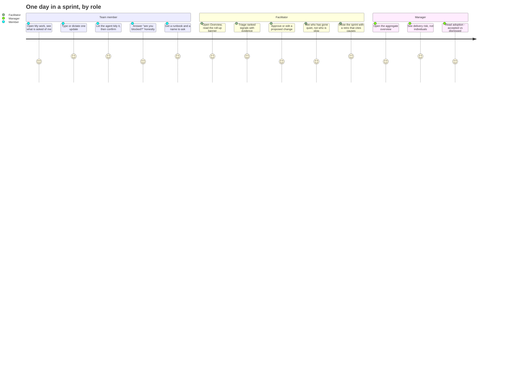

<details><summary>What to check when reviewing it</summary>

- Is any step in the member row more than one interaction? (It should not be.)
- Does the manager row ever reach an individual's record? (No.)

</details>

## 4 · Data model

_The entities and tables, and the rule that nothing derived is ever stored._

### Data model today

**Built today** · ER diagram · source: [`src/18-data-model.mmd`](diagrams/src/18-data-model.mmd)

The entities and their tables: a base snapshot of what the tracker gave us, the append-only decision log, and the run log.

> **How to read it.** Look for what is NOT a column: there is no attention score, no signal and no confidence anywhere. Those are computed on read, which is what makes "the score equals the sum of the reasons" enforceable.

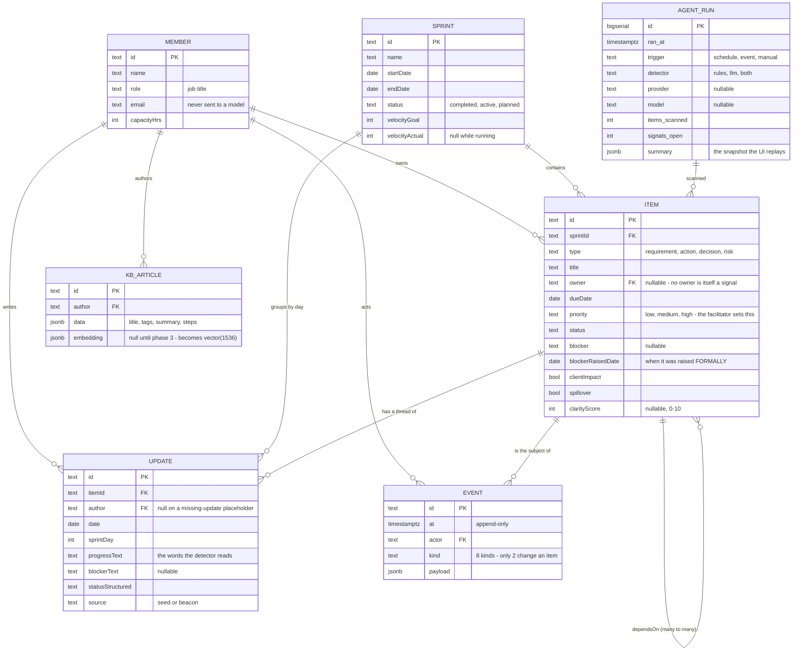

<details><summary>What to check when reviewing it</summary>

- Could any stored field drift out of agreement with a computed one?
- Is anything in EVENT.payload that belongs in a column for querying?

</details>

## 5 · Running it

_Deployment today, what the logs already tell you, and the threats each control answers._

### Deployment today — three ways to run it

**Built today** · deployment · source: [`src/19-deployment-now.mmd`](diagrams/src/19-deployment-now.mmd)

The public static export, the full local/WSL stack, and the container stack — with what each one genuinely can and cannot do.

> **How to read it.** The red box in the first column is the honest part: the public URL has no API, so no shared log, no live agent and no model calls. The other two columns are the real system.

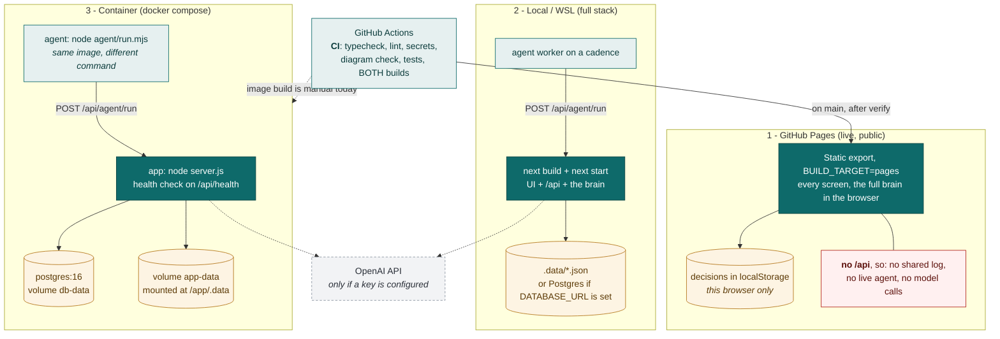

<details><summary>What to check when reviewing it</summary>

- Is the limitation of the public demo visible to a visitor? (Yes — the privacy card names the live store.)
- What is not automated yet? (The container image build.)

</details>

### Observability — how you find out something is wrong

**Partly built** · flowchart · source: [`src/28-observability.mmd`](diagrams/src/28-observability.mmd)

What the system already emits (logs, run rows, health, adoption counters) and the phase-4 collection and alerting around it.

> **How to read it.** Left column is today; the purple middle is infrastructure a pilot adds. The right column is the useful part of this diagram: four alerts worth acting on, including one that is about the product being wrong rather than down.

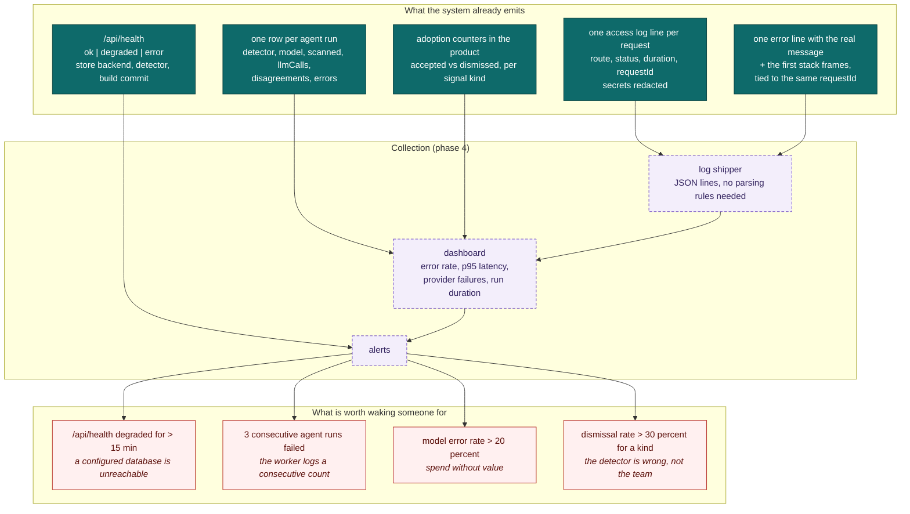

<details><summary>What to check when reviewing it</summary>

- Could an operator diagnose a failed update without shell access? (Yes — requestId in the response and the log.)
- Is there a metric that would catch the agent being annoying rather than broken? (Dismissal rate.)

</details>

### Threat model — threat to control

**Partly built** · flowchart · source: [`src/27-threat-model.mmd`](diagrams/src/27-threat-model.mmd)

Seven threat classes, each paired with the control that answers it and where that control lives in the code.

> **How to read it.** Read right to left to audit: for each control, ask whether it is in the code today. One row is purple — spoofing — because there is no authentication yet. That gap is stated here rather than papered over.

```mermaid
flowchart LR
  subgraph threats["Threat"]
    direction TB
    T1["Spoofing<br/>anyone can claim to be anyone"]
    T2["Tampering<br/>audit log edited or truncated"]
    T3["Repudiation<br/>'I never approved that'"]
    T4["Information disclosure<br/>data reaching a model, or a log"]
    T5["Denial of service<br/>or a runaway model bill"]
    T6["Elevation of privilege<br/>a manager seeing individuals"]
    T7["Injection<br/>hostile input through the API"]
  end

  subgraph controls["Control"]
    direction TB
    C1["<b>phase 4</b>: SSO, server-side role checks.<br/><i>Today: actor is a trusted string -<br/>stated as a gap, not hidden</i>"]
    C2["append-only log; only retention and<br/>instance reset remove rows, and each<br/>records itself; atomic file writes;<br/>corrupt files quarantined, never overwritten"]
    C3["every decision carries actor + time + payload;<br/>undo is a new event, not a deletion"]
    C4["first names only to the model; one item thread;<br/>no decision log sent; secrets redacted from logs;<br/>errors not echoed in production; rules-only default"]
    C5["per-route rate limits; single-flight runs;<br/>per-attempt and total deadlines on model calls;<br/>body size caps; retries bounded"]
    C6["manager view is aggregate by construction:<br/>People is not in the manager nav and<br/>per-person detail returns a team-only note"]
    C7["schema validation on every route; unknown keys<br/>dropped; ids pattern-checked; parameterised SQL;<br/>CSP, nosniff, frame-ancestors none"]
  end

  T1 --> C1
  T2 --> C2
  T3 --> C3
  T4 --> C4
  T5 --> C5
  T6 --> C6
  T7 --> C7

  classDef core fill:#0E6A6A,stroke:#07403F,color:#FFFFFF
  classDef gate fill:#FFF0F0,stroke:#B3261E,color:#5C100B
  classDef future fill:#F3EEFB,stroke:#6B46C1,color:#32225E,stroke-dasharray:5 3
  class T1,T2,T3,T4,T5,T6,T7 gate
  class C2,C3,C4,C5,C6,C7 core
  class C1 future
```

<details><summary>What to check when reviewing it</summary>

- Is any control a document rather than code?
- Which threat would you fix first for a pilot? (Spoofing — SSO plus server-side role checks.)

</details>

## 6 · Future phases (not built)

_Phase 4 (pilot) and phase 5 (enterprise). Purple, dashed boxes do not exist yet — that is the whole point of this section._

### Target architecture (phases 4–5)

**Not built yet** · C4 container · source: [`src/20-target-containers.mmd`](diagrams/src/20-target-containers.mmd)

What a pilot and then an enterprise deployment add: SSO, a sync service, a job queue, Redis, audit/export, and metrics.

> **How to read it.** Everything solid exists today and is not replaced; every purple dashed box is new. The shape of the argument is that the brain and the API survive unchanged — what grows around them is infrastructure.

```mermaid
flowchart TB
  subgraph clients["Clients"]
    direction LR
    WEBC["Web app<br/><i>built</i>"]
    BOT["Teams / Slack bot<br/>answer a question, post an update<br/><i>phase 4</i>"]
  end

  subgraph edge["Edge"]
    direction LR
    IDP["Identity provider (SSO)<br/>OIDC - groups to roles<br/><i>phase 4</i>"]
    GW["Ingress<br/>TLS, HSTS, rate limit<br/><i>phase 4</i>"]
  end

  subgraph svc["Beacon services"]
    direction TB
    APIX["API + UI<br/>role checks ENFORCED server side<br/><i>built, enforcement phase 4</i>"]
    BRAINX["The brain<br/><i>built, unchanged</i>"]
    SYNC["Tracker sync service<br/>webhooks in, approved writes out,<br/>conflict detection<br/><i>phase 4</i>"]
    QUEUE["Job queue + scheduler<br/>runs, syncs, digests, retries<br/><i>phase 4</i>"]
    AUDIT["Audit + export service<br/>subject access, pseudonymisation<br/><i>phase 4 / 5</i>"]
  end

  subgraph data["Data"]
    direction LR
    PGX[("Postgres<br/>+ pgvector for the KB<br/><i>built; vectors phase 3/4</i>")]
    REDIS[("Redis<br/>shared rate limits, locks, cache<br/><i>phase 4</i>")]
    OBJ[("Object store<br/>audit exports, snapshots<br/><i>phase 5</i>")]
  end

  subgraph obs["Operations"]
    direction LR
    LOGS["Log shipping<br/>JSON lines already emitted<br/><i>built</i>"]
    METRICS["Metrics + alerts<br/>run failures, provider errors,<br/>dismissal rate<br/><i>phase 4</i>"]
  end

  TRACKERX["Jira / Azure DevOps<br/>system of record"]
  MODELX["Model provider<br/>OpenAI, or self-hosted"]

  WEBC --> GW
  BOT --> GW
  GW --> IDP
  GW --> APIX
  APIX --> BRAINX
  APIX --> PGX
  APIX --> REDIS
  QUEUE --> APIX
  QUEUE --> SYNC
  SYNC <-->|"REST + webhooks"| TRACKERX
  APIX --> MODELX
  AUDIT --> PGX
  AUDIT --> OBJ
  APIX --> LOGS
  SYNC --> LOGS
  LOGS --> METRICS

  classDef core fill:#0E6A6A,stroke:#07403F,color:#FFFFFF
  classDef inproc fill:#E6F0F0,stroke:#0E6A6A,color:#0B3B3B
  classDef store fill:#FDF4E3,stroke:#B4761A,color:#5C3A06
  classDef external fill:#F2F3F5,stroke:#8A93A0,color:#2A2F38,stroke-dasharray:4 3
  classDef future fill:#F3EEFB,stroke:#6B46C1,color:#32225E,stroke-dasharray:5 3
  class WEBC,APIX,BRAINX core
  class PGX,OBJ store
  class TRACKERX,MODELX external
  class BOT,IDP,GW,SYNC,QUEUE,AUDIT,REDIS,METRICS future
  class LOGS inproc
```

<details><summary>What to check when reviewing it</summary>

- Does anything purple require rewriting something solid?
- Which purple box is required before two replicas can run? (Redis.)

</details>

### Data flow — two-way tracker sync (phase 4)

**Not built yet** · DFD level 1 · source: [`src/21-dfd-two-way-sync.mmd`](diagrams/src/21-dfd-two-way-sync.mmd)

How tracker changes come in and approved changes go out: four mapped fields, an approval gate, an idempotent outbox, and an explicit conflict path.

> **How to read it.** Follow 1 → 9, then look at 10. The conflict branch is the design decision worth reviewing: when the tracker changed under us, Beacon re-raises it for a person instead of overwriting.

```mermaid
flowchart TB
  TRK(["Jira / Azure DevOps"])
  WH["<b>1 Webhook receiver</b><br/>verify signature, dedupe by delivery id"]
  PULL["<b>2 Poll fallback</b><br/>JQL / WIQL since last cursor"]
  MAP["<b>3 Field mapping</b><br/>status - priority - blocker flag - comments"]
  UPS["<b>4 Upsert base snapshot</b><br/>with a change cursor per item"]
  RUN["<b>5 Re-analyse the touched items</b><br/>event-triggered run"]
  GATE{"<b>6 Approval gate</b><br/>a human approves the<br/>preview, or it is not sent"}
  OUT["<b>7 Outbox</b><br/>idempotency key per change,<br/>retry with backoff"]
  CONF{"<b>8 Still current?</b><br/>compare the cursor we read<br/>with what the tracker has now"}
  WRITE["<b>9 Write</b><br/>transition, comment, priority, flag<br/>labelled AI-assisted"]
  CONFLICT["<b>10 Conflict</b><br/>do not overwrite - re-raise<br/>for a person with both versions"]

  D1[("D1 base snapshot<br/>+ sync cursor")]
  D2[("D2 decision log<br/>append-only")]
  D5[("D5 outbox<br/>pending, sent, failed")]

  TRK -->|"issue updated"| WH --> MAP
  TRK -->|"missed events"| PULL --> MAP
  MAP --> UPS --> D1
  UPS --> RUN
  RUN -->|"signals + proposals"| GATE
  GATE -->|"approved"| OUT
  GATE -->|"rejected - recorded, nothing sent"| D2
  OUT --> D5
  OUT --> CONF
  CONF -->|"yes"| WRITE --> TRK
  CONF -->|"no - changed under us"| CONFLICT --> GATE
  WRITE -->|"result + tracker id"| D2

  classDef core fill:#0E6A6A,stroke:#07403F,color:#FFFFFF
  classDef store fill:#FDF4E3,stroke:#B4761A,color:#5C3A06
  classDef external fill:#F2F3F5,stroke:#8A93A0,color:#2A2F38,stroke-dasharray:4 3
  classDef gate fill:#FFF0F0,stroke:#B3261E,color:#5C100B
  classDef future fill:#F3EEFB,stroke:#6B46C1,color:#32225E,stroke-dasharray:5 3
  class TRK external
  class WH,PULL,MAP,UPS,RUN,OUT,WRITE future
  class GATE,CONF,CONFLICT gate
  class D1,D2,D5 store
```

<details><summary>What to check when reviewing it</summary>

- Is this a mirror? (No — four fields, deliberately.)
- What stops a double write after a retry? (An idempotency key per change.)

</details>

### Sequence — webhook in, approved write out (phase 4)

**Not built yet** · sequence · source: [`src/22-seq-webhook-writeback.mmd`](diagrams/src/22-seq-webhook-writeback.mmd)

A tracker edit triggers a scoped run; an approved change is written back only after re-checking that the issue has not moved.

> **How to read it.** Two guards carry this diagram: deduplication at the receiver (so a burst of edits is not a burst of model calls) and the cursor re-check before writing (so nothing is silently overwritten).

```mermaid
sequenceDiagram
  autonumber
  participant TR as Jira / Azure DevOps
  participant WH as Webhook receiver
  participant Q as Job queue
  participant BE as Beacon run
  participant SA as Facilitator
  participant OB as Outbox

  TR->>WH: issue updated (signed payload)
  WH->>WH: verify the signature and dedupe on the delivery id
  WH->>Q: enqueue "re-analyse REQ-001"
  Note over WH,Q: a burst of 50 edits becomes a few jobs, not 50 model calls
  Q->>BE: event-triggered run, scoped to the touched items
  BE->>BE: facts, score, signals (the same brain, unchanged)
  BE->>SA: signal and proposal preview, with the evidence
  alt approved
    SA->>OB: approve, optionally after editing the text
    OB->>TR: read the issue again. Is our cursor still current?
    alt unchanged
      OB->>TR: transition, comment or priority, labelled AI-assisted
      TR-->>OB: accepted, with the new version
      OB->>OB: record it as sent, with the tracker id and the event id
    else changed under us
      OB--xSA: conflict. Here is what you approved and what it says now
      Note over OB,SA: never overwritten silently
    end
  else rejected
    SA->>OB: reject, with a reason
    Note over SA,OB: recorded in the decision log and nothing is sent
  end
```

<details><summary>What to check when reviewing it</summary>

- What happens to a conflict? (It goes back to the person with both versions.)
- Is the write labelled in the tracker? (Yes — AI-assisted.)

</details>

### Deployment target (pilot and enterprise)

**Not built yet** · deployment · source: [`src/23-deployment-target.mmd`](diagrams/src/23-deployment-target.mmd)

A single-tenant, single-region topology: ingress, two app replicas, a worker pool, managed Postgres, Redis, a secret manager, and observability.

> **How to read it.** The note at the bottom is the part that changes code rather than infrastructure: the rate limiter and the run lock are in-process today, so they must move to Redis before a second replica is honest.

```mermaid
flowchart TB
  USERS(["One delivery team<br/>(phase 5: many teams)"])

  subgraph zone["Customer tenant - one region"]
    direction TB
    ING["Ingress / WAF<br/>TLS, HSTS, IP allow list"]
    subgraph app["App tier - 2+ replicas"]
      direction LR
      A1["beacon app"]
      A2["beacon app"]
    end
    WKR["worker pool<br/>agent runs, sync, digests"]
    RDS[("Postgres (managed)<br/>PITR backups, pgvector")]
    RED[("Redis<br/>locks, shared rate limits")]
    SEC["Secret manager<br/>model key, tracker credentials"]
    OBS["Logs, metrics, alerts"]
  end

  IDP2["Customer SSO (OIDC)"]
  TRK2["Jira / Azure DevOps"]
  MOD2["Model provider<br/><i>or self-hosted model for<br/>data-residency customers</i>"]

  USERS --> ING --> app
  ING --> IDP2
  app --> RDS
  app --> RED
  WKR --> RDS
  WKR --> TRK2
  app --> MOD2
  app --> SEC
  WKR --> SEC
  app --> OBS
  WKR --> OBS

  NOTE["<b>Why replicas change the code:</b> the in-process<br/>rate limiter and the single-flight run lock are<br/>per process today. Two replicas need Redis for<br/>both - listed in docs/PRODUCTION-READINESS.md."]
  RED --- NOTE

  classDef person fill:#0F2A4A,stroke:#07192E,color:#FFFFFF
  classDef core fill:#0E6A6A,stroke:#07403F,color:#FFFFFF
  classDef store fill:#FDF4E3,stroke:#B4761A,color:#5C3A06
  classDef external fill:#F2F3F5,stroke:#8A93A0,color:#2A2F38,stroke-dasharray:4 3
  classDef future fill:#F3EEFB,stroke:#6B46C1,color:#32225E,stroke-dasharray:5 3
  class USERS person
  class A1,A2 core
  class RDS,RED,SEC store
  class IDP2,TRK2,MOD2 external
  class ING,WKR,OBS,NOTE future
```

<details><summary>What to check when reviewing it</summary>

- What breaks first if you scale to two replicas without Redis?
- Where does a data-residency customer diverge? (A self-hosted model.)

</details>

### Identity, roles and erasure (phase 4)

**Not built yet** · class diagram · source: [`src/25-identity-model.mmd`](diagrams/src/25-identity-model.mmd)

The model that replaces today's trusted `actor` string: tenants, users linked to an SSO subject, memberships, and an explicit permission set.

> **How to read it.** The two notes are the substance. The permissions list is what each role may do; the user note explains why erasure is pseudonymisation of the actor rather than deletion of events — and why it needs sign-in first.

```mermaid
classDiagram
  class Tenant {
    +id
    +name
    +region "phase 5 - data residency"
    +retentionDays "overrides the default 180"
  }
  class User {
    +id
    +tenantId
    +externalSubject "the OIDC sub - the only identity link"
    +displayName
    +email
    +status "active | pseudonymised"
    +pseudonymise() "keeps the decision, drops the person"
  }
  class Team {
    +id
    +tenantId
    +trackerProjectKey
  }
  class Membership {
    +userId
    +teamId
    +role "facilitator | manager | member"
  }
  class Permission {
    <<enumeration>>
    READ_OWN_WORK
    READ_TEAM_BOARD
    READ_AGGREGATE_ONLY
    DECIDE_SIGNAL
    APPROVE_TRACKER_WRITE
    POST_OWN_UPDATE
    EXPORT_OWN_DATA
    EXPORT_TEAM_LOG
    RESET_INSTANCE
  }
  class Event {
    +id
    +at
    +actorUserId "verified, not claimed"
    +kind
    +payload
  }

  Tenant "1" --> "many" User
  Tenant "1" --> "many" Team
  User "1" --> "many" Membership
  Team "1" --> "many" Membership
  Membership --> Permission : grants
  User "1" --> "many" Event : acted

  note for Membership "member: own work + team board, post own updates\nfacilitator: decide signals, approve writes, export team log\nmanager: AGGREGATE ONLY - never per-person performance"
  note for User "Erasure pseudonymises the actor rather than deleting\nevents: the decision survives for audit, the identity\ndoes not. This needs sign-in to know who is asking,\nwhich is why it is phase 4 and stated, not claimed."
```

<details><summary>What to check when reviewing it</summary>

- Does the manager role hold any permission that could reach an individual?
- After pseudonymisation, is the audit trail still complete? (Yes — the decision survives, the identity does not.)

</details>

### Data model additions (phases 4–5)

**Not built yet** · ER diagram · source: [`src/26-data-model-future.mmd`](diagrams/src/26-data-model-future.mmd)

The new tables: tenancy and users, per-item sync state, an idempotent outbox, KB embeddings, and a daily snapshot row.

> **How to read it.** Compare with diagram 18: nothing existing changes shape, which is why this is additive rather than a migration. SNAPSHOT_DAY is the one that unlocks an honest burndown and cycle time — today's charts only draw the days they really have.

```mermaid
erDiagram
  TENANT ||--o{ TEAM : has
  TENANT ||--o{ APP_USER : has
  TEAM ||--o{ MEMBERSHIP : grants
  APP_USER ||--o{ MEMBERSHIP : holds
  APP_USER ||--o{ EVENT : acts
  TEAM ||--o{ ITEM : scopes
  ITEM ||--o{ SYNC_STATE : "tracked by"
  ITEM ||--o{ OUTBOX : "queued for"
  KB_ARTICLE ||--|| KB_EMBEDDING : "indexed by"
  TEAM ||--o{ SNAPSHOT_DAY : "measured by"

  TENANT {
    uuid id PK
    text name
    text region "phase 5"
    int retention_days
  }
  APP_USER {
    uuid id PK
    uuid tenant_id FK
    text external_subject "OIDC sub"
    text email
    text status "active or pseudonymised"
    timestamptz pseudonymised_at
  }
  MEMBERSHIP {
    uuid user_id FK
    uuid team_id FK
    text role "facilitator, manager, member"
  }
  SYNC_STATE {
    text item_id PK
    text tracker_key "e.g. PORTAL-412"
    text tracker_version "the cursor we last read"
    timestamptz last_pulled_at
    text last_error
  }
  OUTBOX {
    uuid id PK
    text item_id FK
    text idempotency_key "one write, once"
    jsonb change "the approved change"
    text approved_by FK
    text state "pending, sent, conflict, failed"
    int attempts
  }
  KB_EMBEDDING {
    text article_id PK
    vector embedding "1536 - replaces tag overlap"
    text model
  }
  SNAPSHOT_DAY {
    text team_id FK
    date day PK
    int open_items "a real burndown needs a daily row"
    int blocked_items
    int signals_open
    numeric accept_rate
  }
```

<details><summary>What to check when reviewing it</summary>

- Is any new table duplicating something computable? (It should not be.)
- Why store a daily snapshot at all? (A real burndown cannot be reconstructed from current state.)

</details>

### Roadmap — phases 1 to 5

**Partly built** · gantt · source: [`src/24-roadmap.mmd`](diagrams/src/24-roadmap.mmd)

What is done, what is in progress, and what a pilot would take. Dates for phases 1–3 are when the work happened.

> **How to read it.** Read the bar colours, not the calendar: phases 1–3 are complete, and the phase 4–5 bars are sized estimates for a pilot, not commitments. The hardening bar on 14 October is the work covered by docs/PRODUCTION-READINESS.md.

```mermaid
gantt
  title Beacon - phases 1 to 5
  dateFormat YYYY-MM-DD
  axisFormat %b %d
  todayMarker off

  section 1 Honest engine (done)
  Computed attention score, 14 rules      :done, p1a, 2026-10-01, 3d
  Language detector with named phrases    :done, p1b, after p1a, 2d
  Seed reduced to raw facts only          :done, p1c, after p1b, 1d

  section 2 Human in control (done)
  Append-only decision log + undo         :done, p2a, 2026-10-05, 2d
  Preview and approve every change        :done, p2b, after p2a, 2d
  Adoption metrics, privacy panel         :done, p2c, after p2b, 1d

  section 3 Live agent (core done)
  Server store, Postgres or files         :done, p3a, 2026-10-09, 2d
  API, worker clock, LLM behind the seam  :done, p3b, after p3a, 2d
  Retention sweep + stated data policy    :done, p3c, after p3b, 1d
  Production hardening, tests, CI, docs   :done, p3d, 2026-10-14, 1d
  Daily snapshots for real burndown       :active, p3e, 2026-10-20, 5d
  KB semantic match (pgvector)            :p3f, after p3e, 5d

  section 4 Pilot with one team
  SSO and server-side role enforcement    :p4a, 2026-11-03, 10d
  Jira and ADO read sync                  :p4b, after p4a, 10d
  Approved write-back with conflict check :p4c, after p4b, 10d
  Erasure by pseudonymisation             :p4d, after p4a, 5d
  Teams or Slack bot                      :p4e, after p4c, 8d
  Measured first-week baseline            :p4f, after p4e, 5d

  section 5 Enterprise
  Many teams and programme roll-up        :p5a, 2027-02-01, 20d
  Audit export and data residency         :p5b, after p5a, 15d
  WCAG 2.2 AA audit                       :p5c, after p5b, 10d
```

<details><summary>What to check when reviewing it</summary>

- Is anything claimed as done that the tests do not cover?
- Which phase-4 item unblocks the most others? (SSO and server-side roles.)

</details>
